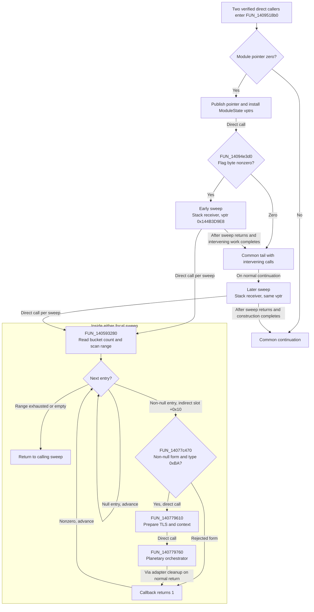

# SRR-003 — Retail allocator invocation and dispatch

## Question and result

**Q1.** What native invocation mechanisms and statically supportable demand
conditions lead to the established planet-level resource allocator in the
pinned retail executable?

**PROVEN STATIC:** The construction path for `StarField::ModuleState`
can enumerate the PNDT form bucket through a stack-resident
`stl::local_function_detail::ILocalFunction` implementation. The iterator
passes each non-null entry to a virtual slot whose target checks the form's
type byte and calls the planet allocator through a direct adapter. The
construction path has an optional early sweep and a later sweep reached
from both flag branches on normal continuation. Both sweeps use the same
callback target. The module-pointer guard, optional flag and per-entry
checks provide the static demand conditions. This is a batch form-processing
path during module-state construction. Association with any named player
operation, the runtime values of the guards and actual retail execution
remain open.

## Evidence identity

Both the installed and analysis-copy `Starfield.exe` measured file and product
version `1.16.244.0` and SHA-256
`7e9adb1414a8e1b325e5e1f097b9b17b78deb7eebeda37a333351a43a60f9d28`.
The PE and saved Ghidra program report image base `0x140000000`. Steam app
`1716740` recorded installed build `23518663` independently. The existing
`Starfield` project, `/Starfield.exe`, matched the SRR-002 project-file and
database digests (domain file ID `c0a816bc892993545618675600` from SRR-002).
Ghidra 12.1.2 PUBLIC with Temurin 21.0.12+8 reported the same import SHA,
`x86:LE:64:default`, and compiler ID `windows`. Five fresh function exports
decompiled, and all 1,089 instruction starts matched the independent PE
decodes from Capstone 5.0.7 on Python 3.14.3. Addresses below are preferred
retail VAs.

The [SRR-002 retail core](SRR-002-retail-static-reconnaissance.md) is the
starting point. The separate [CK pre-biome bundle](experiments/evidence/pre-biome-resource-state/)
and [CK live Galaxy View Apply notes](experiments/x64dbg-runtime-generation-findings.md)
establish CK-specific behavior and a different upstream context. Historical
retail scan outputs have unqualified executable provenance. No plugin data,
reproducer results, or runtime capture was used to infer a retail call edge.
See the [applicability register](PROVENANCE.md#applicability-register).

## Reference ownership

| SRR-002 reference | Native classification |
| --- | --- |
| `0x144B3D9F0` | Absolute pointer at vtable `0x144B3D9E8 + 0x08` to `FUN_14077c470`. The observed iterator uses the other slot. |
| `0x144B3D9F8` | Absolute pointer at vtable `0x144B3D9E8 + 0x10` to the same function. At vtable minus eight, the MSVC complete object locator `0x144FD4B68` resolves the concrete local function implementation and the `ILocalFunction<BSContainer::ForEachResult, TESForm*>` base, both at object offset zero. |
| `0x1485F1500` | PE exception-directory entry with begin RVA `0x77C470`, exclusive end RVA `0x77C491`, and unwind-info RVA `0x541CC78`. The neighboring `0x1485F1398` and `0x1485F13A4` entries describe the adapter and orchestrator. These references describe unwind metadata. |

## Native path and predicates

| Source and site | Target or receiver and condition |
| --- | --- |
| `FUN_141893ee0` at `0x141894CC3` and `FUN_141896280` at `0x141897B59` | Direct calls to `FUN_1409518b0`. These are code-level callers of the construction entry. Their named operation and entry conditions from gameplay remain unresolved. |
| `FUN_1409518b0` at `0x1409518FD–0x1409519BE` | The conditional jump at `0x140951904` bypasses construction when qword `[0x1461E2288]` is nonzero. On the zero path, it publishes `0x1462194F0` to that location at `0x140951916`, installs three vptrs at object offsets 0, 0x10 and 0x18, and calls `FUN_14094e3d0` at `0x1409519BE` with the complete-object address. The locators for those vptrs resolve to `StarField::ModuleState`, with matching offsets. The nonzero path still reaches the common continuation at `0x140951A3C`. |
| `FUN_14094e3d0`, early call at `0x14094E577` | At `0x14094E542` the byte at `0x145EA6000` is compared with zero. Nonzero falls through to install vptr `0x144B3D9E8` into the stack receiver at `[rsp+0x70]`. `R8` holds that address, `DL=0xBA`, and `RCX=[0x145FD9B28]` at the direct call to `FUN_140593280`. Zero jumps to `0x14094EEB4`, skipping the early sweep and its following block. |
| `FUN_14094e3d0`, later call at `0x14094EF57` | Both branches can reach the common tail at `0x14094EEB4` after earlier calls and loops finish. The zero path lands there directly. The other path can reach it through `0x14094EC02 → 0x14094EEAF` when the tested pointer is zero, or by completing the following loop. The code installs the same vptr at `[rbp-0x60]` and passes that receiver in `R8`, the same global owner pointer in `RCX`, and `DL=0xBA`. No repeat test of `0x145EA6000` gates this call. |
| `FUN_140593280` at `0x1405932A2–0x1405932FF` | Computes the bucket at owner + `(uint8(DL)+5)*0x18` (+`0x11E8` for `0xBA`). After acquiring access at `0x1405932B4`, it reads count at bucket +8 and the array pointer at +0x10. Empty count skips the body. It skips null entries, moves a non-null entry to `RDX`, moves the saved receiver from `R14` to `RCX`, and calls `[vptr+0x10]` at `0x1405932EF`. Zero return stops enumeration, nonzero advances. The two constructions above resolve this indirect edge via `0x144B3D9F8` to `FUN_14077c470`. |
| `FUN_14077c470` at `0x14077C474–0x14077C490` | Tests `RDX != 0` and `byte[RDX+0x2E] == 0xBA`. The accepted form moves to `RCX` before the direct call at `0x14077C482` to `FUN_140779610`. Rejected forms and successful returns both produce 1, allowing the iterator to continue. The retail form-descriptor row at `0x1458CF6A0` pairs the tag string at `0x144B02EE8` with a packed `PNDT` signature and the `0xBA` type byte at `0x1458CF6AC`. Adjacent form descriptors and the BIOM and RSGD rows corroborate the interpretation. |
| `FUN_140779610` at `0x14077961F–0x1407796D2` | Saves the form, sets a TLS field to `0x82`, obtains the context pointer from `FUN_1423ff640()` result +`0x8B0` and prepares the thread-local access state. The branches for TLS initialization and a nullable member at context +`0x238` rejoin before the call. At `0x1407796D2` it calls `FUN_140779760` with addresses of the saved form pointer and context pointer. |
| `FUN_140779760` at `0x1407797D8–0x1407797F0` and `0x140779C17–0x140779C92` | Reads the form's +`0x54` key and +`0x50` seed. The collection helper `FUN_14077bce0` exits on a zero key at `0x14077BCE2` and appends work pointers for successful matches. The orchestrator can run with an empty work array. Zero count or an empty range bypasses the per-biome call at `0x140779C86`. A zero seed selects the per-entry reseed path in the loop. |

The outer caller census also reaches `FUN_14187f9d0`, whose input dword
selects calls to `FUN_141893ee0` at `0x14187FA0F` (0) or
`FUN_141896280` at `0x14187FB9B` (1), and two other callers at
`0x14189ABB4` and `0x1418961D9`, respectively. The edge and input-switch
evidence establish upstream alternatives at the native level. The user-facing
meaning of those entry contexts is unqualified.

## Conditional dispatch in pseudocode

The pseudocode and diagram show the two focal generation sweeps on the
[pinned retail image](PROVENANCE.md#current-retail-identity). Names such as
`sweep`, `receiver` and `common_tail` are research aliases. Addresses below
identify preferred VAs. See the [structure register](structure-register.md#retail-dispatch)
for the receiver, bucket and slot layout.

```text
FUN_1409518b0:
    if qword[0x1461E2288] == 0:                     # branch at 0x140951904
        qword[0x1461E2288] = 0x1462194F0
        install the three ModuleState vptrs
        directly call FUN_14094e3d0(0x1462194F0)   # 0x1409519BE
        finish the remaining construction-path work
    continue at 0x140951A3C

FUN_14094e3d0, from the flag test at 0x14094E542:
    if byte[0x145EA6000] != 0:
        sweep(stack receiver at [rsp+0x70])       # direct call at 0x14094E577
        call FUN_14077b1d0, then continue intervening calls and loops
        reach common_tail if that work completes # pointer-zero bypass or loop exit
    else:
        jump to common_tail                     # 0x14094EEB4
    common_tail:
        run preceding calls, including other receiver sweeps
        sweep(stack receiver at [rbp-0x60])      # direct call at 0x14094EF57
        call FUN_14077b1d0 and continue

sweep(receiver):
    install vptr 0x144B3D9E8 in receiver
    directly call FUN_140593280(qword[0x145FD9B28], 0xBA, receiver)

FUN_140593280, for these two callsites:
    compute and acquire access to the type-0xBA bucket
    if count != 0:                               # reads at 0x1405932C7–0x1405932D8
        for each entry in the bucket range:
            if entry is null: continue
            result = indirect call [receiver.vptr + 0x10](receiver, entry)
            if result == 0: break                # 0x1405932EF–0x1405932FF
    run the iterator's exit and release logic

FUN_14077c470(receiver, form):                    # resolved target of +0x10
    if form is non-null and byte[form+0x2E] == 0xBA:
        directly call FUN_140779610(form)        # 0x14077C482
    return 1                                    # also for rejected forms

FUN_140779610(form):
    save the TLS field, set it to 0x82, and prepare access state and context
    directly call FUN_140779760(&saved_form, &saved_context) # 0x1407796D2
    run access cleanup and restore the saved TLS field # 0x1407796D8–0x140779748
```

The nonzero flag path reaches the common tail on normal continuation
through the pointer-zero branch at `0x14094EC02` or after its loop. Other
calls in the tail precede the later sweep. The module-pointer bypass skips
construction through this entry. The flag's origin and runtime value,
outer gameplay association, actual retail invocation and additional paths
remain unresolved. See [native predicates](#native-path-and-predicates) and
[search bounds](#alternative-explanations-and-search-bounds).



The call arrows enter the same iterator from either site. The return resumes
the originating sweep. The iterator's generic zero-result exit is shown in
the pseudocode. The resolved receiver returns 1 on both shown callback paths.

## Alternative explanations and search bounds

- **Metadata or dormant table.** The exception row is metadata. The two
  independently decoded RIP-relative table-base loads and the subsequent
  receiver stores establish active callsite use in the static graph. The
  duplicate `+0x08` slot has no resolved caller here. A table-only or
  registration-only explanation for the resolved `+0x10` edge fails
  because the iterator consumes the stack receiver synchronously and
  supplies its current form directly.
- **Same iterator, different operation.** The nearby sweeps at
  `0x14094EEFD`, `0x14094EF26`, and `0x14094EFBD` resolve through
  their own receiver vtables to `FUN_140799490`, `FUN_140ac7860`, and
  `FUN_14077c4a0`, respectively. The last callback branches at
  `0x14077C4A9` to `FUN_140778600` for type `0xBA`. The same type
  bucket, iterator, and callback interface can invoke different work.
  Both generation sweeps are followed by `FUN_14077b1d0`, whose
  `0x14077B27D` call reaches `FUN_14077a700`. The latter itself
  enumerates the `0xBA` bucket at `0x14077A9AA` with vtable
  `0x144B3DA08`, slot target `FUN_14077c450`. That adapter calls
  `FUN_14077d090`, whose local walk uses the form key and inserts IDs
  at `0x14077D174`. These are distinct direct or resolved dispatch
  edges. Their broader downstream semantics and indirect reachability
  were outside the bounded check.
- **Mandatory early pass or allocation on every invocation.** Zero flag
  skips the early pass. A nonzero module pointer bypasses both via the
  tested construction entry. An empty bucket, null entry, or mismatched
  form byte can also leave the allocator uncalled. An empty biome work
  array leaves the per-biome allocator uncalled after planet entry.
- **Cache miss or named gameplay consumer.** The module-pointer test is
  scoped to construction. No per-planet cache-presence test guards the
  verified direct adapter call. Static evidence supplies neither the
  lifecycle of the module pointer nor the flag's authority and runtime
  value. A byte set through a computed address, or a caller reached only
  in a special context, remains compatible with this graph. UI, scan and
  outpost demand, timing, persistence, effective form resolution,
  descendant multiplicity and model equivalence remain open.

The independent PE census searches byte shapes across file-backed `.text`
(RVA `0x1000–0x3A3EF6B` inclusive). It tests E8/E9 rel32 call/jump
displacements and ModRM mod=00/rm=101 RIP displacements with 0–4
trailing bytes against exact targets. It verifies candidates with Capstone
operand and instruction-boundary checks from the latest preceding
exception-directory range start, from 236,427 unique ranges wholly in that
section. It also searches exact little-endian preferred-VA qwords across
the file-backed extent of every section. The first census had four raw
candidates, all verified in fully decoded ranges. These were the two
known rel32 calls and the two table-base loads. The target-qword search
found only the duplicate wrapper slots among those initial targets. The
constructor census found one inbound rel32 to `FUN_14094e3d0`. The next
census had 196 candidates, including both verified direct calls to
`FUN_1409518b0`; two candidates were in partially decoded ranges and two
were outside the selected ranges, all four for the module pointer. The
only verified exact RIP-relative access to the optional byte in that
census was the comparison above. The alternative-route census had eight
raw candidates, all verified, and included the four outer caller sites
and only the established rel32 call to the per-biome entry. A conditional
rel32 branch such as the final callback's jump is outside E8/E9 coverage.
These scans have no candidate limit. They do not establish exhaustiveness
for short or conditional branches, code outside verified ranges,
base-plus-offset or register-computed references, or dynamically created
indirect targets. Ghidra's saved xrefs provided a separate bounded check.

## Reproduction, publication and next experiment

Start from the [public research repository](https://github.com/gooberpede/starfield-resource-research),
its [retail provenance pin](PROVENANCE.md#current-retail-identity), and
a lawfully obtained matching PE. A verification walk starts at the PE
exception directory (data-directory index 3). At entry VA `0x1485F1500`,
read the three little-endian 32-bit RVAs and add the PE image base to the
first. Disassemble that entry to check the null/type gates and the direct
call at `0x14077C482`. This walk uses the documented
[x64 RUNTIME_FUNCTION layout](https://learn.microsoft.com/en-us/cpp/build/exception-handling-x64#struct-runtime_function)
and the matching executable. It reproduces the metadata classification and
the adapter edge without a saved analysis database.

For the other dispatch claims, on the same PE decode the addresses in
the table, inspect vtable qwords and follow the image-relative RTTI
type-descriptor and base-descriptor links from the listed locators.
With an existing matching analyzed Ghidra program, the repository's
[explicit-address exporter](../ghidra/README.md) can independently export
the relevant listings in place:

    analyzeHeadless <project-directory> Starfield -process Starfield.exe -readOnly -noanalysis -scriptPath ghidra/scripts -postScript ExportFunctionsByAddress.java <ignored-output> 1409518b0 14094e3d0 140593280 14077c470 140779610

The local Ghidra queries reused maintainer-owned `OutpostRecon.java` in
place at sibling revision `d116bc63ff394b0156539161c8d1addfc902665a`.
Its `refall` cap is 4,096 per address, `data` windows are 24 qwords, and
`full` listings are capped at 600 instructions. One initial follow-up
exceeded the 12-query argument cap and produced no report. Smaller
queries and the explicit-address exporter supplied the evidence. The local
`inspect_pe.py` reads the pinned PE using the retained SRR-002 parser and
writes only stdout, redirected to ignored receipts. Its `scan`,
`describe`, `rtti` and `data` commands take preferred VAs as hexadecimal.
Neither reader modifies the Ghidra database. Local filenames and hash
receipts identify exact inputs and outputs. These local scripts and the
sibling query arrangement describe historical custody. The matching-PE
walk and tracked address exporter above are the supported methods.

| Candidate claim | Build and publication basis |
| --- | --- |
| Slot ownership, exception metadata, resolved iterator edge, PNDT dispatch predicates and module-state construction guards | The pinned 1.16.244.0 PE, table/RTTI locators and bounded native instructions above. Verify with the lawful-image procedure. The authored interpretations and locators are eligible for maintainer review. |
| Actual player-facing event, flag source and value, exclusivity, cache lifetime or runtime behavior | Publication hold as established behavior. Resolving those claims needs additional static provenance or separately authorized retail observations. |

Local inspection authority came from the investigation brief. Proprietary
PE excerpts, full listings, decompilations, database files and captures
stay local. See [third-party notices](../THIRD_PARTY_NOTICES.md).

The next discriminating experiment is a separately authorized, bounded
retail trace on the same build. During one nominated initialization
transition, capture the first arrival at RVA `0x5932EF` whose callback
vptr equals image base + `0x4B3D9E8`. Record the iterator's saved return
RVA to distinguish `0x94E57C` and `0x94EF5C`, corresponding to calls at
`0x94E577` and `0x94EF57`. Record the form type byte
and identity, the optional flag, and whether that same call reaches
RVA `0x7796D2`. Include a post-initialization scan of the same body as a
separate bounded observation window if the aim is to distinguish that
scenario from construction. A hit links the nominated scenario to this
route. A miss only bounds the observed window.

## Local verification and handoff

Starting HEAD was `fbf9896f67e07ea4ce28693206db527dc6d18d91` and tree
`559391687b60853b9664ecf1b54cea6fbe48c8b7`. The index and tracked
worktree diffs were empty. The supplied brief was the sole untracked
starting path and is excluded from the task patch. No runtime work was
performed. The project was opened with `-process Starfield.exe -readOnly
-noanalysis`.

Receipts are under `.local-work/codex/SRR-003/`. The Ghidra reports are
`leads.tsv`, `dispatch.tsv`, `controls.tsv` and `core/`. The PE
checks include `rtti.txt`, `control-rtti.txt`, `initial-native.txt`,
`dispatch-native.txt`, `upstream-native.txt`, `caller-controls.txt`,
`listing-comparison.txt` and the census and control outputs. The scoped starting and final
checks record hashes of the executable inputs, analysis project,
dependencies, brief and original index. The caller-available floor was
40,000,000,000 bytes on both drives after growth reserve. Checks are in
`start.json`, `space.log` and `verification-final.json`. The ending
HEAD and index match the starting state. The Git-native task patch is
`.local-work/diffs/SRR-003.diff`. The final verification receipt records
the isolated apply check, replay and byte comparison against every
deliverable.

### SRR-004 editorial revision

SRR-004 adds the conditional dispatch pseudocode, control-flow diagram and explanatory cross-links. The status below identifies the original investigation snapshot.
The [SRR-004 editorial review record](research-workflow.md#srr-004-editorial-review)
identifies the separate snapshot for these additions.

<!-- review-status:start -->
## Review status

**COMPLETE** for the original static-scope Q1. An independent internal
challenger reproduced the focal call displacements, receiver and vtable
linkage, PNDT and unwind metadata, and the module and sweep guards from
the pinned PE. The first round required distinguishing saved return
addresses from call instruction addresses in the proposed experiment.
The final check covers that correction and the byte-exact handoff.
The challenge supports a conditional module-state construction route.
Named gameplay association, runtime guard values, and the existence of
other routes remain open. The review was internal static corroboration.

Reviewed substantive manifest SHA-256
`42fd0085ddb829c4fe52868dbc3ed4812ab69ba313387e693c39024d5bfb54b5`.
It sorts the seven deliverable paths and records each file's SHA-256,
two spaces, its repository-relative path, and LF. Only this marked
review-status block, including the marker lines, is excluded from the
dossier digest. The detailed challenge and manifest are retained under
`.local-work/independent-review/SRR-003/`.

<!-- review-status:end -->
